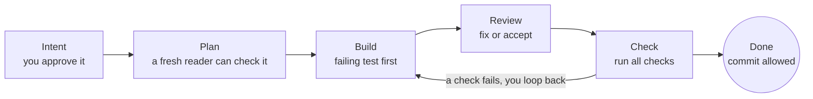

# Temper

**Claude cannot write code before you approve the intent.**

Temper is a Claude Code plugin that runs AI written code through gates you approve: intent, plan, build, review and
check. A small CLI computes each gate from recorded evidence. The model never decides a verdict.

[](CHANGELOG.md)
[](https://opensource.org/licenses/MIT)

[Website](https://galando.github.io/temper) · [Getting Started](docs/getting-started.md) · [Commands](docs/commands.md) · [Releases](https://github.com/galando/temper/releases)

## Install

```text
/plugin marketplace add galando/temper
/plugin install temper
```

On Claude Code 2.1.275 or later one line does both: `/plugin install temper --marketplace galando/temper`.

Then run `/temper:temper "describe the feature"` in your project. The first run adds the config, the `.temper/`
folder and a `pre-commit` hook that blocks `git commit` while a gate is red.

## Why

AI writes code fast, and it fails in predictable ways: happy paths with no edge cases, features nobody asked for,
calls to methods that do not exist, and correct code that nothing uses. Temper checks that the code solves the
problem you approved, and it checks it mechanically instead of asking the model to grade itself.

## How it works

The stages are Intent, Plan, Build, Review, Check, then Done. You decide each gate in one question.



- **Intent first.** You approve the problem and the success criteria before Claude explores or designs.
- **A plan a stranger can build.** At the plan question you can have a reviewer with no context read the plan first; the
  gate stays red while a task would make its builder guess. (`plan.fresh-review: auto` runs it by itself for medium and
  complex work.)
- **Tests first, in small tasks.** Build runs each task as a small agent that writes a failing test, then the code.
- **Computed gates.** `scripts/temper` reads an evidence ledger and prints PASS or FAIL per requirement. You can
  override a gate with a reason; Temper records it.

## Commands

| Command | Purpose |
|---------|---------|
| `/temper:temper "..."` | The whole pipeline, from intent to commit |
| `/temper:fix "..."` | Root cause, a failing regression test, a minimal fix |
| `/temper:intent "..."` | Capture an idea now, build it later |
| `/temper:status` | Quality metrics, the gate ledger and spec drift |

The rest are listed in [Commands](docs/commands.md).

## What's new in v9.7.6

- **Fresh review first** at the plan question: a reviewer with no context reads the plan, and you see its summary.
- A contest of a finding must cite a file the reviewer could read; anything else goes to you.
- A reviewer that did not finish counts as not run, never as a clean review.
- `temper drift` lists where the code moved away from finished specs.

Details: [CHANGELOG.md](CHANGELOG.md) and [the evidence](docs/evidence/fresh-review.md).

## What the mod reads and writes

On Claude Code 2.1.287 or later an optional mod draws the stage bar and refuses writes outside the current stage. It
reads only `.temper/view.json` and its own options and store, makes no network call, and runs no command. The full
list is in [The mod](docs/mod.md#what-the-mod-reads-and-writes).

## More

[Getting Started](docs/getting-started.md) · [Commands](docs/commands.md) · [Trust](docs/trust.md) · [Packs](docs/packs.md) · [Methodology](docs/methodology.md) · [Privacy](https://galando.github.io/temper/privacy.html) · [CONTRIBUTING.md](CONTRIBUTING.md) · MIT © [Gal Naor](https://github.com/galando)
