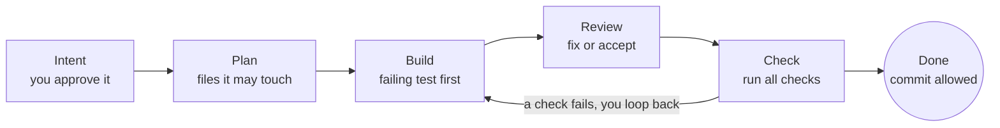

# Temper

**Claude cannot write code before you approve the intent.**

Temper is an intent gated workflow for code that AI writes. A small CLI computes each gate verdict.
The model never decides a verdict. With Claude Code 2.1.287 or later, a mod refuses writes outside
the current stage ([the mod](docs/mod.md)).

[](https://code.claude.com/docs/en/discover-plugins)
[](CHANGELOG.md)
[](docs/mod.md#where-enforcement-works)
[](https://opensource.org/licenses/MIT)

https://github.com/user-attachments/assets/ec84e98e-7c28-45f9-87c2-8df0b80e19b8

[Website](https://galando.github.io/temper) · [Getting Started](docs/getting-started.md) · [Commands](docs/commands.md) · [The mod](docs/mod.md) · [Haiku Build](docs/grouped-build.md) · [Releases](https://github.com/galando/temper/releases)

## Install

```text
/plugin marketplace add galando/temper
/plugin install temper
```

On Claude Code 2.1.275 or later, one line does both:

```text
/plugin install temper --marketplace galando/temper
```

You can also open the Plugins page in Claude, choose **Discover** and search for "temper".

Your first `/temper:temper "describe the feature"` sets up the project. It adds the config, the
`.temper/` folder and a `pre-commit` hook. The hook blocks `git commit` while a gate is red.

The short form `/temper` is an interactive shortcut. It may not work on every surface. Claude Code
2.1.287 or later adds the stage bar and the refusals. Older versions run each stage as a prompt.

## The problem

AI writes code fast, but it fails in predictable ways:

- Happy paths without edge cases.
- Features that nobody asked for.
- Calls to methods that do not exist.
- Correct code that nothing uses.

Most tools check that the code compiles. Temper checks that the code solves the right problem. It does
this mechanically. It does not ask the model to grade itself.

## How it works

One loop, with a human gate at each stage. You review the cheapest artifact first.
The order is Intent, Plan, Build, Review, Check, then Done. You decide each gate in one question.
A failed Review or Check goes back to Build when you choose so.



- **The intent gate comes first.** You approve the problem and the success criteria before Claude
  explores or designs. A wrong intent costs words here. Later, it costs the whole plan.
- **Each gate is computed.** `scripts/temper` is auditable bash with no network. It reads an evidence
  ledger and prints PASS or FAIL for each requirement. A red gate blocks `git commit` through a real
  hook. A person can override a gate, and Temper records who did it. A confused model cannot.
- **The mod makes the stages real.** It refuses writes outside the stage, `--no-verify`, and a step
  only you may take when you did not choose it in the gate question. It draws the stage bar and the
  run's pane; at the end the run prints its report, and writes it as a page when you ask. It is not a
  sandbox: [Trust](docs/trust.md) lists what it does not see, and [the mod](docs/mod.md) has the details.

https://github.com/user-attachments/assets/31a9f4dc-8860-41be-97ca-f03460630f2f

## What the mod reads and writes

The mod makes no network, `process` or `env` call, starts no agent and writes no file itself.

- **Reads:** `.temper/view.json`, the one file the CLI writes for it, its own settings, store and state,
  and the Claude Code version. When you change its mode or enforcement it reads the `/config` list to
  find its own two rows. When `reviewerModel` is set it reads the session's agent list (id and type only).
- **Configuration and environment it sets:** no environment variable. Only its own two settings,
  `temper.uiMode` (when you type `/temper:temper mode`, or answer the mode question your first
  `/temper:temper` asks) and `temper.enforcement` (when you type `/temper:temper enforcement`). A setting
  your organization locked stays as it is.
- **Slash commands it runs, and when:** only `/temper:temper` with no words, written as fixed text, when
  you press Go on in the bar. It never builds a command from data.
- **Hooks, and what each changes:**
  - `tool.call` reads the path of Write, Edit, MultiEdit and NotebookEdit and the text of Bash. It refuses
    a write outside the stage, `--no-verify`, a changed hooks path or a step only you may take, with a
    reason, or passes the call on and returns its result unchanged. After a question dialog it reads your
    answer from the result.
  - `command.run` handles only `/temper:temper`: it answers `status`, `timeline`, `help`, `report`,
    `mode`, `enforcement` and `pane`. Every other word, and every other command, passes on unchanged.
  - `session.start` and `classic.SessionStart` find the project folder and load the run. Both return what
    Claude Code gave them unchanged: they add or change no context, instruction, setting or hook.
  - `prompt.compose` adds one system prompt section, `temper:phase`: enforcement on or off, the stage, the
    run title, the passed criteria and the next step.
  - `turn.step` sets the model and effort from `phaseModels`, and the review agent's model from
    `reviewerModel`; empty options change nothing.
  - `attribution.text` adds one Temper line to a pull request description during a run, when
    `prAttribution` is on.
  - `turn.complete` adds a one line status under an answer in full mode; `ui.render` and `ui.close` draw
    the bar, the pane, the spinner word and the prompt hint, and note a pane you closed.
- **Keeps:** your answers in the question dialogs, the run report and whether you were asked for a mode,
  in its plugin store; the bar's view in `$.state`, which other plugins can read.

Outside your project, Temper reads only its own global pack folder `~/.claude/packs` (if you made one)
and the mod's plugin store. It reads no key, login, transcript or other Claude Code file. It asks git for
your name and email to record who accepted an intent or overrode a gate. The full list is in
[The mod](docs/mod.md#what-the-mod-reads-and-writes).

## Commands

Three you will actually type. `/temper:temper` runs and routes the rest.

| Command | Purpose |
|---------|---------|
| [`/temper:temper "..."`](docs/commands.md#temper-unified-command) | The whole pipeline, intent gate to commit |
| [`/temper:fix "..."`](docs/commands.md#temperfix) | Root cause, a failing test that is write protected, a minimal fix |
| [`/temper:intent "..."`](docs/commands.md#temperintent) | Capture an idea as a committed draft, build it later |

`/temper:temper` also takes `status`, `report`, `pr`, `mode` and `pane`. A word such as `approve` or
`back` only brings up the gate question, where you decide. See [Commands](docs/commands.md#subcommands).

**Granular control.** Each stage on its own: [`/temper:plan`](docs/commands.md#temperplan),
[`/temper:design`](docs/commands.md#temperdesign), [`/temper:build`](docs/commands.md#temperbuild),
[`/temper:review`](docs/commands.md#temperreview), [`/temper:check`](docs/commands.md#tempercheck). Utilities:
[`/temper:status`](docs/commands.md#temperstatus), [`/temper:pack`](docs/commands.md#temperpack), [`/temper:init`](docs/commands.md#temperinit).

**Autonomy (opt in)** runs stages after the plan gate unattended. It never pushes, never merges to a
remote and never makes the feature commit; its only commits are Build's local task commits and merges. **Packs:** [docs/packs.md](docs/packs.md). **CI:** [examples/workflow/README.md](examples/workflow/README.md).

## Documentation, contributing and license

- [Getting Started](docs/getting-started.md) · [Commands](docs/commands.md) · [The mod](docs/mod.md) · [Trust](docs/trust.md) · [Packs](docs/packs.md)
- [Methodology](docs/methodology.md) · [Testing the mod](docs/mods-testing.md) · [AI Native SDLC](docs/ai-native-sdlc.md)
- [Recommended Setup](docs/recommended-setup.md) · [Enterprise](docs/enterprise.md) · [Directory submission](docs/directory-submission.md) · [Privacy](https://galando.github.io/temper/privacy.html)
- [CONTRIBUTING.md](CONTRIBUTING.md) · MIT © [Gal Naor](https://github.com/galando)
