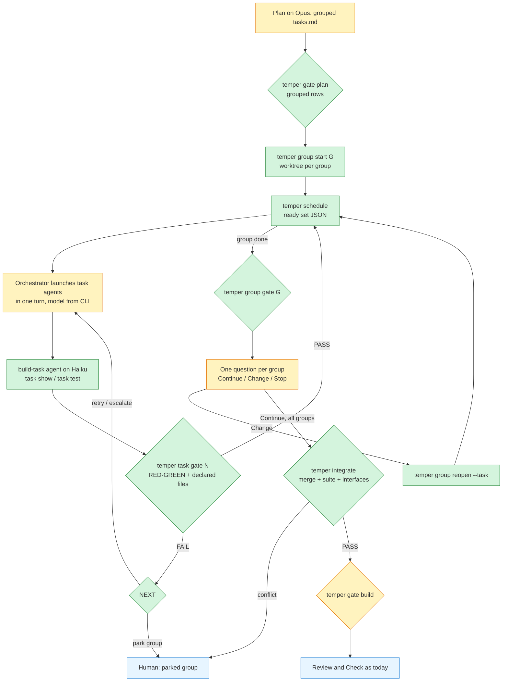

# Plan: Grouped Build with Haiku task agents (Temper 9.7.0)

**Spec:** `.temper/specs/grouped-haiku-build` · **Complexity:** complex · **Risk:** Medium
**Input:** the accepted intent.md (AC-01..AC-15, D-01..D-04). Plan added D-05 and D-06
(the two Deferred questions) and refined AC-02/AC-05 wording, each with its reason in
intent.md.

## Summary

An opt-in `build.mode: grouped` turns Build into a CLI-scheduled run of small task
agents. Plan (Opus) writes tasks.md as groups of tasks; each group carries a short
Context block, and each task declares its files and dependencies. The temper CLI owns
everything with one correct answer: the ready set, file-ownership overlap, per-task,
per-group and integration verdicts, retry/escalation, worktrees and the measurement
record. The orchestrator only loops: ask the CLI what is ready, launch those agents on
the model it printed (in one turn, so they run in parallel), relay each result to
`temper task gate`, act on the one `NEXT:` line it prints, and show one human gate per
group. With the key absent, nothing in the per-task path changes.

## Architecture

### Components

| Layer | Piece | Role |
|---|---|---|
| Config | `build.mode`, `build.grouped.{task-model, escalation-model, max-parallel}` | opt-in switch and model choice (AC-01, AC-06) |
| CLI | `_grouped_parse` | one parser for grouped tasks.md, JSON out, shared by every grouped subcommand |
| CLI | `gate plan` (grouped rows) | declared files, Depends, Context present, budgets, overlap, per-group max-blast-radius (AC-02, AC-03, AC-05, AC-11) |
| CLI | `schedule` | ready set: deps met, group not parked, files disjoint from running tasks, max-parallel (AC-03, AC-04) |
| CLI | `group start` | worktree `.claude/worktrees/temper-{slug}-{G}` on branch `temper/{slug}/{G}` (AC-04) |
| CLI | `task start/show/test/gate` | snapshot, slim payload, CLI-executed RED/GREEN, per-task verdict, tick + pathspec commit (AC-05, AC-07) |
| CLI | retry chain in `task gate` | attempt 1 task model, 2 task model, 3 escalation model, then park group (AC-08, D-03) |
| CLI | `group gate`, `group reopen` | group verdict; Change re-runs only named tasks (AC-09, D-02) |
| CLI | `integrate` + gate build row | merge, full suite, Interfaces check, conflict stops before Review (AC-10) |
| CLI | gate commit (grouped) | blast radius = changed files inside the declared union (AC-11, D-01) |
| CLI | `group report`, `state archive` | tokens per model, attempts, wall time, review findings (AC-12) |
| CLI | write lock | `.temper/.lock` around ledger/state writes; parallel agents append safely |
| Mod | PROTECTED + phaseWriteRule | groups.json CLI-only; writes under a run's group worktree judged by the worktree-relative path |
| Brief | `agents/build-task.md` | slim Haiku brief, <= 6144 bytes (AC-05) |
| Brief/ref | `agents/plan.md`, `reference/plan.md` | grouped tasks.md format (AC-02) |
| Orchestrator | `commands/temper.md` Stage 2 | the launch loop only (AC-13, AC-14) |

### Grouped tasks.md shape (written by Plan, parsed by the CLI)

```
## Group G1: CLI scheduler
**Depends:** none
**Validate:** `bash scripts/selftest/test-temper.sh`
**Interfaces:** `scripts/temper` — `cmd_schedule()`
**Context:**
Shared files, interfaces, conventions and the pack rules that apply (<= 4096 bytes).

### Task 1: ready set [group: G1]
**File:** `scripts/temper`, `scripts/selftest/temper-cases-5.sh`
**Depends:** none
**Traced to:** Scenario: "..."
- [ ] done
```

`### Task N:` stays numeric and `**File:**` keeps its backticked paths, so the mod's
task progress (`planfiles.ts` taskBlocks) and drift allowance (parseTaskFiles) read a
grouped tasks.md unchanged. A top-level `**Integration:**` line names the full suite.

### Files to Create

| File | Why |
|---|---|
| `agents/build-task.md` | slim Haiku task brief (AC-05, AC-13) |
| `scripts/selftest/temper-cases-5.sh` | grouped CLI cases; the four existing case files stay under their reading size |
| `tests/mod/worktree.test.ts` | mod rule for group-worktree writes and groups.json |
| `docs/grouped-build.md` | user guide + AC-12 measurement procedure |
| `docs/decisions/0011-grouped-build.md` | decision record (repo practice, as 0009 did for checkpoints) |

### Files to Modify

| File | Change |
|---|---|
| `scripts/temper` | config, model task, parser, plan/build/commit gate rows, schedule, group, task, integrate, report, lock, clear/archive, help |
| `scripts/selftest/test-temper.sh` | source temper-cases-5.sh |
| `hooks/temper-mod/core/bash.ts` | PROTECTED gains `.temper/groups.json` |
| `hooks/temper-mod/core/rules.ts` | phaseWriteRule maps `.claude/worktrees/temper-{slug}-G{n}/` paths |
| `agents/plan.md` | one step: grouped output when `build.mode` is grouped |
| `reference/plan.md` | "Grouped tasks" section: format, budgets, splitting, Context content |
| `templates/tasks.md` | grouped example |
| `templates/temper.config.default` | commented `build:` block |
| `commands/temper.md` | Stage 2 "Grouped mode" launch loop |
| `reference/autonomy.md` | grouped auto-continue, park on parked group, D-01 meaning |
| `reference/orchestrator-patterns.md` | groups.json in the state schema |
| `docs/getting-started.md` | config keys, link to docs/grouped-build.md |
| `.claude-plugin/plugin.json` | `./agents/build-task.md`; version 9.7.0 |
| `README.md`, `docs/index.html`, `.claude/CLAUDE.md` | 9.7.0 (version-bump.sh) |
| `CHANGELOG.md` | 9.7.0 entry |

Create 5, modify 18. Every file traces to a scenario or a stated infrastructure need in
tasks.md.

## Blast Radius

```
BLAST RADIUS — grouped-haiku-build
  Direct impact:    scripts/temper (modify) → called by commands/*.md, agents/*.md,
                    9 of 11 scripts/guards/*.sh (block-uncommitted-gate, verify-stage-gate,
                    stage-marker, block-protected-paths, confirm-override, among them),
                    the native pre-commit hook (install.sh writes `temper gate commit`),
                    and the mod (cli.ts names the exact calls it asks Claude to run)
  Direct impact:    _json_append / _json_set_path (modify: lock) → every evidence add/run,
                    state set/advance/loop — every stage of every run [HEURISTIC]
  Direct impact:    gate_plan / gate_build / gate_commit (modify, grouped-only rows) →
                    gates.json → the mod's gates.ts and commit rule read the verdicts
  Direct impact:    hooks/temper-mod/core/rules.ts phaseWriteRule (modify) → every Write/Edit
                    during build/fix for every user with enforcement active
  Direct impact:    hooks/temper-mod/core/bash.ts PROTECTED (modify) → protectedKind, used by
                    rules.ts for every Bash and write call
  Transitive impact: tests/mod/* (49 files) exercise rules.ts/bash.ts through world.ts
  Transitive impact: scripts/selftest/temper-cases-1.sh:668-670 assert `model --all` prints
                    exactly 8 stage lines → grouped lines must be conditional
  Risk areas:       concurrency — parallel agents call `temper task test` at once; today's
                    read-modify-write in _json_append would drop rows (no lock exists)
  Risk areas:       per-task changed-file attribution inside one shared group worktree is
                    by snapshot hash; a task that edits a SIBLING's declared file while
                    the sibling runs is charged to the sibling (residual, documented)
  Risk areas:       test runners that recurse into `.claude/worktrees/` (jest, pytest
                    rootdir) can pick up worktree copies while a group runs
  Architectural compliance:
    [ok]   gate logic only in scripts/temper, each with a test-temper.sh case (cases-5)
    [ok]   per-stage logic in agents/ briefs; commands/temper.md gains the loop only
    [ok]   new agent listed in plugin.json; validate-panels.py enforces it
    [ok]   hooks fail open: the lock times out to a WARN, never a wedge
    [warn] the CLI makes git commits/merges for the first time (task pathspec commits on
           group branches, integration merges on the feature branch) — local only, never
           a push; the final feature commit still faces `gate commit` and stays human
```

**Security hot paths.** Classified per reference/plan.md:

| File | Level | Entry point | Exposure | Note |
|---|---|---|---|---|
| `hooks/temper-mod/core/rules.ts` (write rule) | HIGH (permission) | PreToolUse hook on Write/Edit/Bash | INTERNAL (local session) | a too-wide worktree mapping would let a subagent write unplanned files; mapping is pinned to the run's own slug prefix and re-applies the same rule — scenario "The mod allows a planned write in a group worktree and refuses an unplanned one" |
| `hooks/temper-mod/core/bash.ts` (PROTECTED) | HIGH (permission) | PreToolUse hook | INTERNAL | groups.json must be CLI-only or a model could forge task verdicts — same scenario |
| `scripts/temper` gate_commit | HIGH (validate) | native pre-commit hook, in-agent commit hook | INTERNAL | grouped blast-radius rule only replaces the count when grouped is on; scenario "Autonomy commit gate in grouped mode compares changes to the declared union" |

No CRITICAL file (no auth, crypto, payment, secret or token code). No PUBLIC exposure:
everything runs in the developer's own session.

**Consumers with regression guards:** per-task Build and its selftest cases (scenario
"Grouped mode off keeps the per-task Build unchanged"); the mod's 49 test files
(`claude plugin test .` in Task 12 and Task 19); the commit hooks (Task 5 case: a CLI
commit in a worktree passes the native hook; existing commit-gate cases unchanged).

## Approach Decisions

### Orchestrator-launched task agents (not group agents that launch their own tasks)

- **Alternative:** one agent per group that launches its task agents (nesting works by
  default per current Claude Code docs, up to three layers).
- **Pros:** shorter orchestrator loop; group-local retries.
- **Cons:** the user can set `CLAUDE_CODE_MAX_SUBAGENT_SPAWN_DEPTH=1`; the group agent's
  context grows with every task result; scheduling would sit in a prompt.
- **Why not chosen:** AC-13 requires the run to work with nesting off, and AC-03 puts
  scheduling in the CLI; a group agent would be a second, non-deterministic scheduler
  whose context cost grows linearly with the tasks it supervises.

### CLI-managed worktrees (not the subagent `isolation: worktree` field)

- **Alternative:** declare `isolation: worktree` in agents/build-task.md frontmatter.
- **Pros:** no worktree code in the CLI; automatic cleanup.
- **Cons:** per the docs it branches from the default branch, not the feature branch;
  it gives each task (not each group) its own copy; and it fails Bash commands that
  resolve to the main checkout.
- **Why not chosen:** the task agent must run `temper task test` from the main checkout
  (the run's `.temper` lives there), tasks of one group must share one tree to see each
  other's work, and a default-branch base would miss the approved plan commit.

### Group context as a block in tasks.md (not a separate context file per group)

- **Alternative:** `.temper/specs/{slug}/groups/G1.md` files.
- **Pros:** matches the original AC-02 wording literally.
- **Cons:** the spec folder holds exactly intent.md, tasks.md and plan.md
  (reference/plan.md hard rule) and gate plan reads only those; a fourth artifact also
  needs mod write allowances during Plan.
- **Why not chosen:** it breaks the three-file rule that the plan gate, the mod's Plan
  write rule and the committed-artifact chain all rely on; `temper task show` gives the
  agent the same bytes from one source.

### Task agents never commit; the CLI commits a task's declared paths at task-gate PASS

- **Alternative:** the per-scenario commit of agents/build.md step 5, done by each task agent.
- **Pros:** same habit as per-task mode.
- **Cons:** parallel agents in one worktree fight over `index.lock`; a commit in a
  worktree sees no run state and skips the gate; Haiku gets one more step to get wrong.
- **Why not chosen:** a pathspec commit made by the CLI after its own verdict is
  serialized by the CLI lock and only ever contains declared files, which is the
  property the task gate just proved.

## Context Gaps

- No `- unavailable:` source in intent.md's Context Sources; the `none:` line (launch
  prompt only, no ticket) leaves no hidden decision.
- The ~64 KB per-launch figure is the request's; this plan does not re-measure it.
  AC-12's procedure measures the real numbers after release (D-04).
- The two Deferred Open Questions are settled as D-05 (nesting) and D-06 (budgets).

## Cross-Repo Search

- not available: no cross-repo code search tool (Sourcegraph or similar) is connected to this session; blast radius and prior art come from local grep of this repo and the current Claude Code subagent docs (code.claude.com/docs/en/sub-agents).

## Diagram


